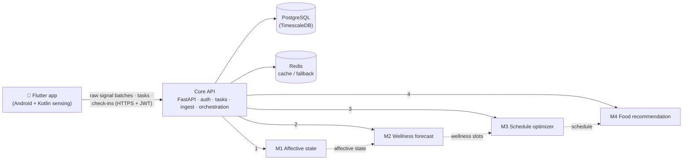

# J26-SE-360

Final year research project of J26-SE-360 about **"AI-Driven Cognitive Wellness Framework Using Multimodal Sensing System for Personalized Nutrition and Adaptive Schedule Optimization"** (SLIIT IT4010, CoEAI).

<!-- Replace OWNER with the GitHub account that hosts the repo -->
[](https://github.com/OWNER/J26-SE-360/actions/workflows/ci.yml)

An Android app collects smartphone signals (camera heart rate, typing rhythm, screen and app use, activity, light, short check-ins) without any wearable. A server detects the user's current affective state, forecasts their cognitive wellness for the coming hours, builds a schedule that tasks are likely to be completed in, and recommends meals that fit that day. Each of those four steps is one research module, owned by one team member.

## Team

| Module | What it does | Owner | Reg. no. | Folder |
|---|---|---|---|---|
| M1 — Affective State Detection | Current affective state from raw phone signals | J.D. Jayatilake | IT23279698 | `services/m1-affective-state` |
| M2 — Cognitive Wellness Prediction | Hour-by-hour forecast of fatigue, focus, energy, burnout risk | J.M. Samarathunga | IT23401662 | `services/m2-wellness-prediction` |
| M3 — Predictive Adaptive Schedule Optimization | Predicts task completion, builds and regenerates the schedule | G.W.D.D.N. Kumarasinghe (tech lead) | IT23267336 | `services/m3-schedule-optimizer` |
| M4 — Context-Aware Food Recommendation | Meal recommendations fitted to state, wellness and schedule | T.C. Gunaweera | IT23174658 | `services/m4-food-recommendation` |
| Shared | Core API, mobile app, contracts | Everyone | — | `backend/`, `mobile/`, `contracts/` |

## Architecture



- The phone only **collects and uploads**. All feature extraction and every model runs on the server ([ADR-0004](docs/adr/0004-server-side-processing.md)).
- The core API is the only service that touches the database. Module services are **stateless**: request in, prediction out.
- Data flows one way, M1 → M2 → M3 → M4. The core API passes each result to the next module. Dotted arrows show logical flow, not direct calls.
- Every message format is defined once in [`contracts/`](contracts/) ([ADR-0006](docs/adr/0006-contracts-single-source.md)).

More detail: [docs/architecture.md](docs/architecture.md).

## Repository map

```
contracts/                      Shared Pydantic contracts + exported JSON Schemas (everyone)
backend/core-api/               FastAPI core: auth, users, tasks, sensor ingest, pipeline
services/m1-affective-state/    M1 service + training code (Jayatilake)
services/m2-wellness-prediction/M2 service + training code (Samarathunga)
services/m3-schedule-optimizer/ M3 service + training code (Kumarasinghe)
services/m4-food-recommendation/M4 service + training code (Gunaweera)
mobile/wellness_app/            Flutter app (Android-first, Kotlin sensing plugins)
docs/                           Architecture, setup, API, privacy, decisions (ADRs)
scripts/                        Dev helpers: seed data, simulate a phone upload
docker-compose.yml · Makefile · .env.example
```

Each module service has the same shape: `app/` serves the model, `src/<pkg>/` holds training and research code, `notebooks/` for exploration, `models/` for trained artifacts (not in git except `model_card.json`), `tests/`.

Datasets never go in this repo. They live in a sibling folder, `../07-datasets`, and code finds them through `DATA_DIR`.

## Quick start

You need Git, Docker Desktop, Python 3.12 and Make. Full step-by-step instructions for Windows and macOS: [docs/setup-guide.md](docs/setup-guide.md).

```bash
git clone https://github.com/OWNER/J26-SE-360.git
cd J26-SE-360
cp .env.example .env      # local settings — never commit .env
make setup                # Python tools, pre-commit hooks, contracts package
make up                   # PostgreSQL, Redis, core API and the four module services
make simulate             # sends a fake phone upload and runs the full M1→M4 pipeline
```

Then open **http://localhost:8000/docs** for the interactive core API. Each module also has its own docs page at ports 8101–8104 (`/docs`).

Mobile app: see [mobile/wellness_app/README.md](mobile/wellness_app/README.md).

## Read next

| If you want to… | Read |
|---|---|
| Set up your laptop | [docs/setup-guide.md](docs/setup-guide.md) |
| Understand how the pieces fit | [docs/architecture.md](docs/architecture.md) |
| Know every endpoint and payload | [docs/api-contracts.md](docs/api-contracts.md) |
| Work on your module day to day | [docs/development-workflow.md](docs/development-workflow.md) |
| Branch, commit and open a PR | [CONTRIBUTING.md](CONTRIBUTING.md) |
| Know what data we collect and why | [docs/data-and-privacy.md](docs/data-and-privacy.md) |
| See why we chose this stack | [docs/adr/](docs/adr/) |
| See what the team still has to agree | [docs/open-issues.md](docs/open-issues.md) |

## Licence

MIT — see [LICENSE](LICENSE).
