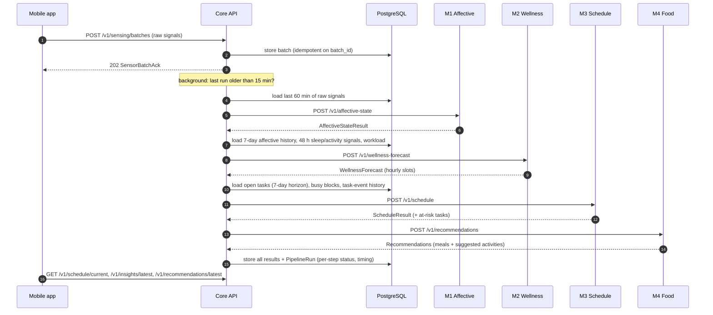

# Architecture

## Components

| Component | Tech | Responsibility | Owner |
|---|---|---|---|
| Mobile app | Flutter (Dart) + Kotlin | Login, tasks, check-ins, camera heart-rate capture, background collection of raw signals, offline upload queue, showing schedule / insights / meals | Shared |
| Core API | FastAPI, SQLAlchemy, Alembic | Auth (JWT), users and consent, tasks + task-event log, raw sensor ingest, pipeline orchestration, storing every module result, fallbacks | Tech lead (M3) |
| PostgreSQL 16 | TimescaleDB image | All persistent data: users, tasks, raw signals, module outputs, pipeline runs | Core API only |
| Redis | Redis 7 | Cache of latest module outputs (fast reads, fallback when a module is slow or down) | Core API only |
| M1 service | FastAPI + Python ML | Raw signals for a time window → affective state + extracted features | Jayatilake |
| M2 service | FastAPI + Python ML | Affective history + sleep/activity signals + workload → hour-by-hour wellness forecast | Samarathunga |
| M3 service | FastAPI + XGBoost / OR-Tools | Tasks + wellness forecast + user history → schedule with completion probabilities | Kumarasinghe |
| M4 service | FastAPI + Python ML | State + forecast + schedule + diet profile → meal recommendations (+ suggested activities) | Gunaweera |
| Contracts | Pydantic package | Single definition of every message; JSON Schemas exported for the app | Everyone |

Only the core API talks to the database. Module services are **stateless** — they receive everything they need in the request and return a prediction. That keeps each module independently testable, swappable and easy to explain in your own report.

## Ports

| Service | Port | Docs |
|---|---|---|
| core-api | 8000 | http://localhost:8000/docs |
| m1-affective-state | 8101 | http://localhost:8101/docs |
| m2-wellness-prediction | 8102 | http://localhost:8102/docs |
| m3-schedule-optimizer | 8103 | http://localhost:8103/docs |
| m4-food-recommendation | 8104 | http://localhost:8104/docs |
| postgres | 5432 | — |
| redis | 6379 | — |

Inside Docker Compose, services reach each other by service name (e.g. `http://m3-schedule-optimizer:8103`).

## Data flow

1. **Collect.** The app records raw signals on the phone (see [data-and-privacy.md](data-and-privacy.md)) and stores them in a local queue.
2. **Upload.** Every ~15 minutes (WorkManager) the app sends a `SensorBatch` to `POST /v1/sensing/batches`. Each batch has a `batch_id`, so re-sending after a network failure is safe.
3. **Store.** The core API validates the batch against the contract and stores the raw signals.
4. **Run the pipeline.** After an upload — if the last run is older than `PIPELINE_MIN_INTERVAL_MINUTES` — or on demand (`POST /v1/pipeline/run`), the core API calls the four modules in order and stores each result.
5. **Show.** The app reads the current schedule, latest insights and meal recommendations from the core API.

### One pipeline run

## Fallback behaviour

A research prototype must keep working when one module is broken or slow:

- Every module call has a timeout (`MODULE_TIMEOUT_SECONDS`, default 10 s).
- If a step fails or times out, the core API uses that module's **last stored result** as the input to the next step and marks the step `used_fallback: true` in the `PipelineRun`.
- If there is no previous result: M3 schedules with a **neutral wellness profile**, M4 recommends without wellness context. The run status becomes `partial`, not `failed`.
- `POST /v1/schedule/regenerate` calls **only M3**, using the cached wellness forecast. This keeps re-planning fast (no chained M1 → M2 calls), which addresses the 2-second latency concern.

## Schedule regeneration

M3 owns *when* things happen. The core API asks for a new schedule when:

- the pipeline runs (new wellness forecast);
- the user adds, edits or completes a task (`reason: task_added`, …);
- a task's slot passes without completion (`reason: task_missed`);
- M3 itself flags `overload_predicted` or at-risk tasks on the previous run.

M4's suggested activities never go straight into the schedule. The user accepts one in the app, it becomes an ordinary task, and M3 schedules it on its next run. Data flows one way only: M1 → M2 → M3 → M4.

## Why this design

| Decision | Short reason | Record |
|---|---|---|
| Flutter + Kotlin, Android-first | One UI codebase; Kotlin for sensing APIs Flutter plugins don't cover; iOS blocks app-usage and typing signals | [ADR-0001](adr/0001-mobile-flutter-kotlin.md) |
| Core API + one service per module | Each member owns and is marked on a clear unit; no shared ML dependency conflicts | [ADR-0002](adr/0002-core-api-plus-module-services.md) |
| PostgreSQL + own JWT auth | Full control of research data, SQL for analysis, easy export, no third-party data host | [ADR-0003](adr/0003-postgresql-and-own-auth.md) |
| All processing on the server | One place for feature extraction and models; phones only collect | [ADR-0004](adr/0004-server-side-processing.md) |
| Monorepo + trunk-based flow | One clone, one CI, contracts and consumers change together | [ADR-0005](adr/0005-monorepo-and-git-workflow.md) |
| Pydantic contracts as single source | One definition per message; schemas for Flutter generated from it | [ADR-0006](adr/0006-contracts-single-source.md) |
